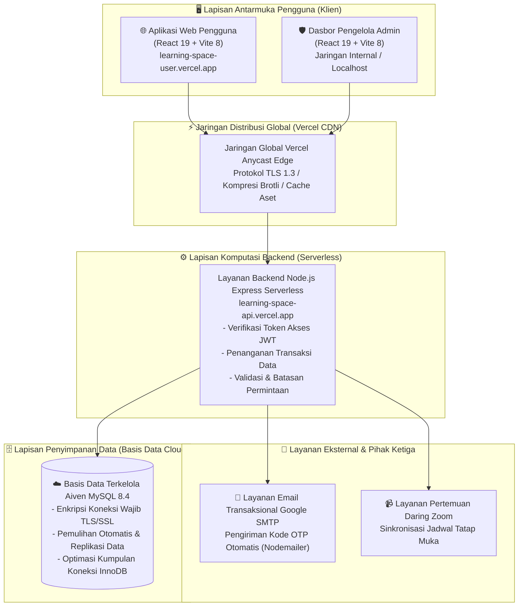

<div align="center">
  
  
  <h2>LearningSpace</h2>
  <p><strong>Arsitektur Pembelajaran Daring Modern untuk Pelajar Indonesia</strong></p>

  <p align="center">
    Platform ekosistem pembelajaran digital komprehensif, tangguh, dan terukur yang dirancang khusus untuk pelajar modern Indonesia. Dibangun dengan arsitektur <strong>Klien-Server Terpisah</strong>, <strong>API Tanpa Server (Serverless)</strong>, dan <strong>Basis Data Komputasi Awan (Cloud Database)</strong>.
  </p>

  <p align="center">
    <a href="https://learning-space-user.vercel.app"></a>
    <a href="https://learning-space-api.vercel.app"></a>
    <a href="https://aiven.io"></a>
  </p>

  <p align="center">
    
    
    
    
    
    
    
  </p>
</div>

---

## 📌 Daftar Isi
- [Ikhtisar Platform](#-ikhtisar-platform)
- [Arsitektur Sistem](#-arsitektur-sistem)
- [Fitur Utama](#-fitur-utama)
- [Struktur Monorepo Repository](#-struktur-monorepo-repository)
- [Tata Kelola Tim & Pembagian Cabang Kerja](#-tata-kelola-tim--pembagian-cabang-kerja)
- [Standar Keamanan & Perlindungan Data](#-standar-keamanan--perlindungan-data)
- [Panduan Instalasi & Pengembangan Lokal](#-panduan-instalasi--pengembangan-lokal)
- [Spesifikasi REST API](#-spesifikasi-rest-api)
- [Alur Integrasi & Penyebaran Otomatis (CI/CD)](#-alur-integrasi--penyebaran-otomatis-cicd)
- [Lisensi & Kontribusi](#-lisensi--kontribusi)

---

## 💡 Ikhtisar Platform

**LearningSpace** adalah platform teknologi pendidikan (*ed-tech*) menyeluruh yang memadukan modul multimedia, ruang kelas virtual interaktif (integrasi Zoom), analisis progres belajar waktu nyata (*real-time*), dan sistem otomatisasi pengingat jadwal belajar (*Reminder Engine*). 

Sistem ini memisahkan secara modular antara **Portal Pengguna (Pengalaman Belajar Pelajar)**, **Pusat Kendali Admin (Dasbor Pengelola)**, dan **Layanan API Tanpa Server (Serverless Micro-API)** berdaya tahan tinggi.

---

## 🏛️ Arsitektur Sistem

Platform didesain mengusung arsitektur berbasis komputasi awan yang modular dan terpisah:



---

## ✨ Fitur Utama

### 1. 🎓 Portal Belajar Pengguna (`learning-space`)
* **Otentikasi & Pemulihan Akun Aman**: Masuk dan pendaftaran aman berbasis JWT (JSON Web Token), verifikasi akun dengan kode OTP 6-digit via email, serta alur reset kata sandi (*Lupa Kata Sandi*).
* **Penjelajahan Kelas Terstruktur**: Modul pembelajaran interaktif (Kimia, Matematika, Fisika, Sejarah, Bahasa Indonesia, Komputer) dilengkapi pemutar video, rangkuman teks, dan status ketuntasan bab.
* **Kelas Favorit & Riwayat Belajar**: Pengarsipan otomatis modul yang sedang atau telah dipelajari dengan pembaruan tampilan langsung (*Optimistic UI*).
* **Sesi Belajar Langsung (Tatap Muka)**: Integrasi informasi jadwal kelas tatap muka daring melalui Zoom Meeting.
* **Analisis & Statistik Kemajuan Belajar**: Visualisasi diagram progres materi, rekam jejak konsistensi belajar harian (*streak*), dan persentase ketuntasan kurikulum.
* **Pengingat Jadwal Belajar**: Manajemen jadwal pengingat belajar mandiri terintegrasi di bilah samping (*Sidebar Reminder*).

### 2. 🛡️ Dasbor Pusat Kendali Admin (`learning-space-admin`)
* **Statistik Sistem Terkini**: Ringkasan data menyeluruh (total peserta terdaftar, jumlah kelas aktif, total modul materi, dan sesi pertemuan daring berjalan).
* **Manajemen & Moderasi Pengguna**: Pengelolaan hak akses, pemblokiran/pembukaan akun pengguna (*suspend/unsuspend*), dan pembersihan akun.
* **Pengelolaan Kurikulum & Silabus**: Tambah, edit, dan hapus silabus mata pelajaran, urutan materi modul, tautan video, serta deskripsi modul.
* **Ulasan & Katalog Layanan**: Moderasi testimoni kepuasan pelajar dan pengelolaan daftar paket layanan yang tersedia.

---

## 📂 Struktur Monorepo Repository

```text
Project PemWeb/
├── .gitignore                      # Pengecualian berkas git global (Node, sistem operasi, log)
├── README.md                       # Dokumentasi teknis proyek dalam Bahasa Indonesia
├── CONTRIBUTING.md                 # Panduan kolaborasi dan alur kerja pengembang
├── CHANGELOG.md                    # Catatan riwayat pembaruan versi
│
├── learning-space/                 # 🚀 Klien: Portal Pengguna (Aplikasi Web Pelajar)
│   ├── src/
│   │   ├── api/axios.js            # Klien HTTP Axios dengan injeksi token JWT otomatis
│   │   ├── components/             # Komponen antarmuka yang dapat digunakan kembali
│   │   ├── pages/                  # Halaman aplikasi (Dasbor, Detail Kelas, Profil, dll.)
│   │   └── App.jsx                 # Konfigurasi rute dengan pemuatan dinamis (lazy load)
│   ├── vercel.json                 # Pengalihan rute aplikasi halaman tunggal (SPA)
│   └── package.json
│
├── learning-space-admin/           # 🛡️ Pengelola: Portal Khusus Operator & Administrator
│   ├── src/
│   │   ├── api/axios.js            # Klien Axios dengan autentikasi admin
│   │   ├── pages/                  # Modul kelola admin (Manajemen Pengguna, Kelas, dll.)
│   │   └── App.jsx
│   └── package.json
│
└── learning-space-api/             # ⚙️ Inti: Layanan RESTful API Tanpa Server (Serverless)
    ├── config/
    │   └── database.js             # Konfigurasi ORM Sequelize dengan negosiasi SSL otomatis
    ├── controllers/                # Logika bisnis (autentikasi, pengguna, kelas, analitik)
    ├── middleware/                 # Middleware otentikasi JWT, hak akses, dan batas unggah
    ├── models/                     # Definisi entitas tabel basis data relasional
    ├── routes/                     # Penentuan rute REST API
    ├── utils/                      # Fungsi utilitas (pengirim email SMTP, validator)
    ├── server.js                   # Berkas utama aplikasi & entry point Vercel Serverless
    ├── vercel.json                 # Spesifikasi pembangunan fungsi tanpa server Vercel
    └── package.json
```

---

## 👥 Tata Kelola Tim & Pembagian Cabang Kerja

Repository ini menerapkan standardisasi alur kerja kolaboratif dengan pembagian tugas yang jelas untuk setiap anggota tim:

| Anggota Tim | Peran Teknis | Tanggung Jawab Modul | Cabang Kerja GitHub (*Branch*) |
|:---|:---|:---|:---|
| **Ridho Putra Aulia** | **Arsitek Backend & Pimpinan Teknis** | API Serverless, Pengelolaan Basis Data, Penyebaran Cloud, Sistem Admin | [`backend/ridho-putra`](https://github.com/RidhoPtraDev/learning-space/tree/backend/ridho-putra)<br>[`admin/ridho-putra`](https://github.com/RidhoPtraDev/learning-space/tree/admin/ridho-putra)<br>[`database/ridho-putra`](https://github.com/RidhoPtraDev/learning-space/tree/database/ridho-putra) |
| **Arviandra Deska** | **Pimpinan Pengembang Frontend** | Antarmuka Pengguna Web, Manajemen State Klien, Integrasi API | [`frontend/arviandra-deska`](https://github.com/RidhoPtraDev/learning-space/tree/frontend/arviandra-deska) |
| **Muhammad Lukman** | **Desainer Produk & UI/UX** | Desain Pengalaman Pengguna, Tata Letak Visual, Panduan Gaya Antarmuka | [`ui-ux/muhammad-lukman`](https://github.com/RidhoPtraDev/learning-space/tree/ui-ux/muhammad-lukman) |
| **Pengelola Rilis** | **Insinyur DevOps & Rilis** | Pengujian Integrasi, Uji Kualitas, dan Penerbitan Produksi | [`main`](https://github.com/RidhoPtraDev/learning-space/tree/main) |

---

## 🔒 Standar Keamanan & Perlindungan Data

* **Pencegahan Kebocoran Kredensial**: Informasi sensitif (`JWT_SECRET`, URL basis data, sandi email) **tidak disimpan** di dalam repositori publik. Seluruh kredensial dikelola melalui *Environment Variables* terenkripsi di platform Vercel.
* **Perlindungan Terhadap SQL Injection**: Menggunakan ORM *Sequelize* dengan mekanisme *parameterized queries* pada seluruh manipulasi data.
* **Enkripsi Kata Sandi**: Seluruh kata sandi pengguna dienkripsi menggunakan algoritma *hashing* `bcryptjs` sebelum disimpan ke basis data.
* **Keamanan Jalur Komunikasi**: Seluruh pertukaran data dilindungi protokol **HTTPS / TLS 1.3** di sisi web serta sambungan terenkripsi **SSL/TLS** antara server API dan basis data Aiven Cloud.
* **Kendali Akses Berbasis Peran (RBAC)**: Pemisahan hak akses antara akun `user` dan `admin` yang diverifikasi secara ketat pada setiap permintaan API.

---

## 🚀 Panduan Instalasi & Pengembangan Lokal

### 📋 Prasyarat Sistem
* [Node.js](https://nodejs.org/) versi `>= 18.x` (Direkomendasikan v20 LTS atau v22)
* [Git](https://git-scm.com/)
* Basis data MySQL (dapat menggunakan XAMPP untuk pengujian lokal, atau koneksi Aiven Cloud)

### 1. Salin Repositori (Clone)
```bash
git clone https://github.com/RidhoPtraDev/learning-space.git
cd learning-space
```

### 2. Konfigurasi dan Jalankan Layanan API Backend
```bash
cd learning-space-api
npm install

# Buat berkas .env dari contoh yang tersedia
cp .env.example .env

# Jalankan server dalam mode pengembangan lokal
npm run dev
```
> Server API akan aktif pada alamat: `http://localhost:5000`

### 3. Jalankan Portal Belajar Pengguna (Frontend User)
```bash
cd ../learning-space
npm install
npm run dev
```
> Portal Pengguna akan aktif pada alamat: `http://localhost:5173`

### 4. Jalankan Dasbor Admin (Frontend Admin)
```bash
cd ../learning-space-admin
npm install
npm run dev
```
> Dasbor Admin akan aktif pada alamat: `http://localhost:5174`

---

## 📡 Spesifikasi REST API

| Metode | Titik Akhir (*Endpoint*) | Akses | Keterangan |
|:---:|:---|:---:|:---|
| `POST` | `/api/auth/register` | Publik | Pendaftaran akun baru dan pengiriman kode verifikasi OTP |
| `POST` | `/api/auth/verify-otp` | Publik | Validasi kode OTP 6-digit untuk aktivasi akun |
| `POST` | `/api/auth/login` | Publik | Verifikasi kredensial dan penerbitan token akses JWT |
| `POST` | `/api/auth/forgot-password`| Publik | Permintaan kode OTP untuk reset kata sandi |
| `GET`  | `/api/users/profile` | Wajib Login | Mengambil informasi profil akun yang sedang masuk |
| `PUT`  | `/api/users/profile` | Wajib Login | Memperbarui informasi profil pengguna |
| `GET`  | `/api/kelas` | Wajib Login | Mengambil seluruh katalog mata pelajaran |
| `GET`  | `/api/kelas/:id` | Wajib Login | Mengambil rincian materi dari kelas tertentu |
| `GET`  | `/api/favorit` | Wajib Login | Mengambil daftar kelas favorit yang disimpan pengguna |
| `GET`  | `/api/analitik/progress` | Wajib Login | Mengambil ringkasan statistik dan progres belajar |
| `GET`  | `/api/admin/dashboard` | Khusus Admin | Mengambil data metrik sistem untuk dasbor pengelola |

---

## 🔄 Alur Integrasi & Penyebaran Otomatis (CI/CD)

```
[Komit Git] ──> [Pemeriksaan Keamanan Rahasia GitHub] ──> [Pemicu Otomatis Vercel]
                                                                    │
                     ┌──────────────────────────────────────────────┴──────────────────────────────────────────────┐
                     ▼                                                                                             ▼
          [Pembangunan Produksi Frontend Vite]                                                         [Pembangunan API Serverless]
          - Pemisahan Kode (*Code Splitting*)                                                          - Integrasi Dinamis Driver MySQL2
          - Minifikasi Aset (*Brotli & Gzip*)                                                          - Injeksi Kredensial Terenkripsi
                     │                                                                                             │
                     ▼                                                                                             ▼
       [Aplikasi Web: learning-space-user]                                                           [Layanan API: learning-space-api]
```

* **Alamat Aplikasi Web Pengguna**: [https://learning-space-user.vercel.app](https://learning-space-user.vercel.app)
* **Alamat Layanan API**: [https://learning-space-api.vercel.app](https://learning-space-api.vercel.app)

---

## 📜 Lisensi & Kontribusi

Didistribusikan di bawah naungan **Lisensi MIT**. Silakan buka berkas [`LICENSE`](./LICENSE) untuk membaca ketentuan lisensi lengkap.

Panduan kontribusi teknis dan alur pengajuan perubahan dapat dibaca pada berkas **[CONTRIBUTING.md](./CONTRIBUTING.md)**.

<div align="center">
  <sub>Dibangun dengan dedikasi untuk mendukung kemajuan pendidikan berkualitas bagi pelajar di seluruh Indonesia. © 2026 Tim Pengembang LearningSpace.</sub>
</div>
