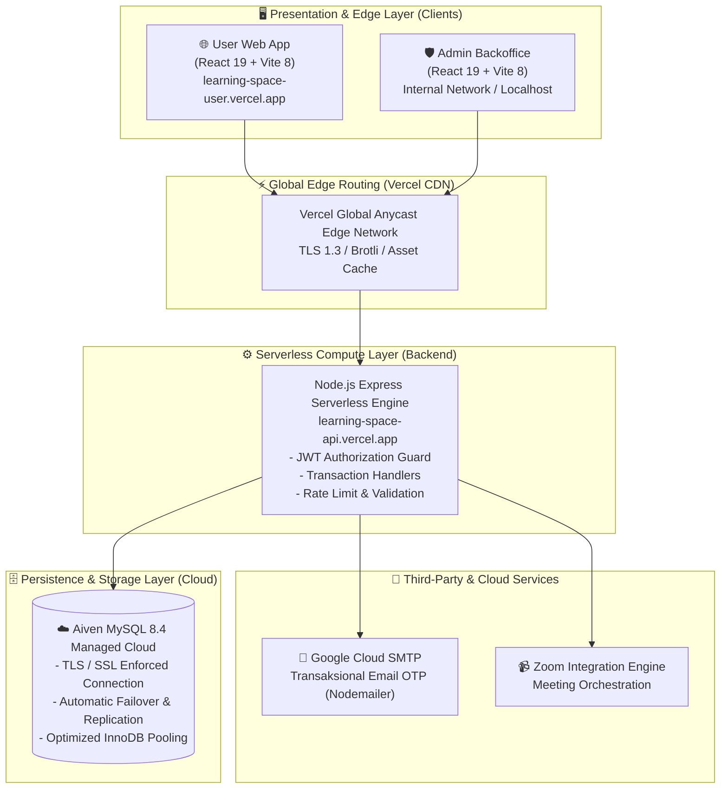

<div align="center">
  
  
  # LearningSpace Platform
  ### *Enterprise-Grade E-Learning Architecture & Modern Student Engagement Platform*

  <p align="center">
    Platform ekosistem pembelajaran digital komprehensif, tangguh, dan terukur yang dirancang khusus untuk pelajar modern Indonesia. Dibangun dengan arsitektur <strong>Decoupled Client-Server</strong>, <strong>Serverless Micro-API</strong>, dan <strong>High-Availability Cloud Database</strong>.
  </p>

  <p align="center">
    <a href="https://learning-space-user.vercel.app"></a>
    <a href="https://learning-space-api.vercel.app"></a>
    <a href="https://aiven.io"></a>
  </p>

  <p align="center">
    
    
    
    
    
    
    
  </p>
</div>

---

## 📌 Daftar Isi
- [Ikhtisar Platform](#-ikhtisar-platform)
- [Arsitektur Sistem Tingkat Perusahaan](#-arsitektur-sistem-tingkat-perusahaan)
- [Fitur Utama & Domain Bisnis](#-fitur-utama--domain-bisnis)
- [Struktur Monorepo Repository](#-struktur-monorepo-repository)
- [Tata Kelola Tim & Strategi Branching](#-tata-kelola-tim--strategi-branching)
- [Standar Keamanan & Perlindungan Data](#-standar-keamanan--perlindungan-data)
- [Panduan Instalasi & Pengembangan Lokal](#-panduan-instalasi--pengembangan-lokal)
- [Spesifikasi REST API Terpilih](#-spesifikasi-rest-api-terpilih)
- [Alur CI/CD & Deployment](#-alur-cicd--deployment)
- [Lisensi & Kontribusi](#-lisensi--kontribusi)

---

## 💡 Ikhtisar Platform

**LearningSpace** adalah platform ed-tech end-to-end yang memadukan materi multimedia, ruang kelas virtual interaktif (Zoom integration), analisis progres belajar real-time, dan manajemen otomatisasi pengingat (*Reminder Engine*). 

Dikembangkan mengacu pada standar rekayasa perangkat lunak perusahaan teknologi modern (*Big Tech Standard*), sistem ini memisahkan secara modular antara **Portal Pengguna (User Experience)**, **Pusat Kendali Administrasi (Backoffice Command Center)**, dan **Core Micro-API** berdaya tahan tinggi.

---

## 🏛️ Arsitektur Sistem Tingkat Perusahaan

Platform didesain mengusung arsitektur decoupled berorientasi cloud (*Cloud-Native Decoupled Architecture*):



---

## ✨ Fitur Utama & Domain Bisnis

### 1. 🎓 Student Experience Ecosystem (`learning-space`)
* **Multi-Factor Authentication & Recovery**: Otentikasi aman berbasis JWT (JSON Web Token), verifikasi email instan dengan OTP 6-digit transaksional, serta alur pemulihan kata sandi (*Forgot Password flow*).
* **Interactive Class Discovery**: Katalog kelas terstruktur (Kimia, Matematika, Fisika, Sejarah, Bahasa Indonesia, Komputer) lengkap dengan video player adaptif, ringkasan materi, dan progress checklist.
* **Smart Favorit & Riwayat Belajar**: Pengarsipan otomatis modul yang dipelajari secara non-blocking (*Optimistic UI update*).
* **Live Synchronous Sessions**: Integrasi jadwal tatap muka daring melalui modul Zoom Meeting terkurasi.
* **Learning Analytics & Insights**: Visualisasi diagram kemajuan belajar, retensi harian (*learning streak*), dan kalkulasi persentase ketuntasan kurikulum.
* **Custom Reminder Engine**: Sistem pengingat jadwal belajar dan sesi tatap muka terintegrasi.

### 2. 🛡️ Administrative Command Center (`learning-space-admin`)
* **Live System Metrics**: Ringkasan metrik analitik (total peserta, katalog kelas aktif, load materi, sesi zoom berjalan).
* **User Governance & Moderation**: Manajemen izin akses, status penangguhan (*soft-ban/unban*), dan kontrol akun.
* **Curriculum Lifecycle Management**: Manajemen CRUD penuh silabus, penataan materi, video embed, dan aset modul.
* **Feedback & Service Catalog**: Moderasi ulasan testimoni peserta dan manajemen paket layanan platform.

---

## 📂 Struktur Monorepo Repository

```text
Project PemWeb/
├── .gitignore                      # Global git exclusion (Node, OS, logs, secrets)
├── README.md                       # Enterprise Technical Documentation
├── CONTRIBUTING.md                 # Developer workflow & git guidelines
├── CHANGELOG.md                    # Release history & breaking changes
│
├── learning-space/                 # 🚀 Client: Portal Pelajar (User Facing Web)
│   ├── src/
│   │   ├── api/axios.js            # Axios client instance (interceptor & JWT injection)
│   │   ├── components/             # Reusable atomic UI components (Sidebar, Badges, etc.)
│   │   ├── pages/                  # Route view components (Dashboard, KelasDetail, Profil)
│   │   └── App.jsx                 # Lazy-loaded route definitions with Suspense boundary
│   ├── vercel.json                 # Single-Page-Application (SPA) edge rewrites
│   └── package.json
│
├── learning-space-admin/           # 🛡️ Backoffice: Portal Operator & Administrator
│   ├── src/
│   │   ├── api/axios.js            # Admin authorized Axios client
│   │   ├── pages/                  # Backoffice modules (ManajemenUser, Kelas, Analytics)
│   │   └── App.jsx
│   └── package.json
│
└── learning-space-api/             # ⚙️ Core: RESTful Serverless Micro-API
    ├── config/
    │   └── database.js             # High-resilience Sequelize instance (SSL auto-negotiation)
    ├── controllers/                # Business logic separation (auth, user, kelas, analitik)
    ├── middleware/                 # JWT Auth, role verification, safe serverless upload
    ├── models/                     # Relational entity definitions (ORM Model Schemas)
    ├── routes/                     # Granular REST endpoint routes
    ├── utils/                      # Helper modules (SMTP Mailer, Validators)
    ├── server.js                   # Application bootstrap & Vercel Serverless entrypoint
    ├── vercel.json                 # Serverless builder specification (@vercel/node)
    └── package.json
```

---

## 👥 Tata Kelola Tim & Strategi Branching

Repository ini menerapkan standardisasi **Trunk-Based Collaborative Branching** dengan pemisahan tugas berbasis kapabilitas (*Domain-Driven Responsibility*):

| Anggota Tim | Peran Teknis (*Technical Role*) | Tanggung Jawab Modul | Branch Kerja Terisolasi |
|:---|:---|:---|:---|
| **Ridho Putra Aulia** | **Tech Lead & Backend Architect** | REST Micro-API, Database Engine, Serverless Deployment, Admin Core | [`backend/ridho-putra`](https://github.com/RidhoPtraDev/learning-space/tree/backend/ridho-putra)<br>[`admin/ridho-putra`](https://github.com/RidhoPtraDev/learning-space/tree/admin/ridho-putra)<br>[`database/ridho-putra`](https://github.com/RidhoPtraDev/learning-space/tree/database/ridho-putra) |
| **Arviandra Deska** | **Lead Frontend Engineer** | User Interface Portal, State Management, Client Routing, API Integration | [`frontend/arviandra-deska`](https://github.com/RidhoPtraDev/learning-space/tree/frontend/arviandra-deska) |
| **Muhammad Lukman** | **Product & UI/UX Designer** | Desain Interaksi, Komponen Visual, User Journey, Brand Guideline | [`ui-ux/muhammad-lukman`](https://github.com/RidhoPtraDev/learning-space/tree/ui-ux/muhammad-lukman) |
| **Release Maintainer** | **DevOps & Release Engineer** | Staging, Quality Assurance, Production Rollout | [`main`](https://github.com/RidhoPtraDev/learning-space/tree/main) |

---

## 🔒 Standar Keamanan & Perlindungan Data

* **Zero-Secret Commitment**: Kredensial sensitif (`JWT_SECRET`, database URI, SMTP tokens) **tidak pernah** dimasukkan ke dalam version control. Seluruh rahasia dikelola melalui *Vercel Encrypted Environment Secrets*.
* **SQL Injection Mitigation**: Menggunakan ORM *Sequelize* dengan parameterized prepared statements secara menyeluruh.
* **Cryptographic Hashing**: Seluruh kata sandi pengguna dienkripsi menggunakan algoritma `bcryptjs` dengan *adaptive salt rounds*.
* **Transport Security**: Enkripsi penuh **HTTPS / TLS 1.3** pada layer web server dan **SSL/TLS encrypted socket** saat berkomunikasi dengan Aiven Cloud Database.
* **Granular Role-Based Access Control (RBAC)**: Pemisahan tegas hak akses `user` dan `admin` melalui middleware verifikasi claims token JWT.

---

## 🚀 Panduan Instalasi & Pengembangan Lokal

### 📋 Prasyarat Sistem
* [Node.js](https://nodejs.org/) versi `>= 18.x` (Disarankan v20 LTS atau v22)
* [Git](https://git-scm.com/)
* Database MySQL (XAMPP lokal untuk pengujian offline, atau koneksi Aiven Cloud)

### 1. Kloning Repository
```bash
git clone https://github.com/RidhoPtraDev/learning-space.git
cd learning-space
```

### 2. Konfigurasi & Menjalankan Backend API
```bash
cd learning-space-api
npm install

# Buat file .env dari template
cp .env.example .env

# Jalankan server dalam mode development
npm run dev
```
> Server API akan aktif pada: `http://localhost:5000`

### 3. Menjalankan Portal Pengguna (Frontend User)
```bash
cd ../learning-space
npm install
npm run dev
```
> Portal Pengguna akan aktif pada: `http://localhost:5173`

### 4. Menjalankan Backoffice Admin (Frontend Admin)
```bash
cd ../learning-space-admin
npm install
npm run dev
```
> Backoffice Admin akan aktif pada: `http://localhost:5174`

---

## 📡 Spesifikasi REST API Terpilih

| Method | Endpoint | Akses | Deskripsi |
|:---:|:---|:---:|:---|
| `POST` | `/api/auth/register` | Publik | Pendaftaran akun baru & pengiriman OTP |
| `POST` | `/api/auth/verify-otp` | Publik | Validasi OTP 6-digit & aktivasi akun |
| `POST` | `/api/auth/login` | Publik | Otentikasi kredensial & penerbitan Bearer Token |
| `POST` | `/api/auth/forgot-password`| Publik | Permintaan pemulihan akun via OTP email |
| `GET`  | `/api/users/profile` | Terotentikasi | Mendapatkan data profil pengguna aktif |
| `PUT`  | `/api/users/profile` | Terotentikasi | Memperbarui data pengguna |
| `GET`  | `/api/kelas` | Terotentikasi | Katalog seluruh mata pelajaran & modul |
| `GET`  | `/api/kelas/:id` | Terotentikasi | Rincian silabus dan bab materi spesifik |
| `GET`  | `/api/favorit` | Terotentikasi | Daftar kelas yang disimpan pengguna |
| `GET`  | `/api/analitik/progress` | Terotentikasi | Metrik analitik ketuntasan & aktivitas |
| `GET`  | `/api/admin/dashboard` | Admin Only | Ringkasan metrik kesehatan sistem |

---

## 🔄 Alur CI/CD & Deployment

```
[Git Commit] ──> [GitHub Main Push Protection] ──> [Vercel Automated Webhook]
                                                              │
                     ┌────────────────────────────────────────┴────────────────────────────────────────┐
                     ▼                                                                                 ▼
          [Frontend Vite Production Build]                                             [@vercel/node Serverless Build]
          - Code Splitting & Chunking                                                  - MySQL2 Dynamic Module Linking
          - Asset Minification (Gzip/Brotli)                                           - Environment Secret Injection
                     │                                                                                 │
                     ▼                                                                                 ▼
         [Deploy: learning-space-user]                                                 [Deploy: learning-space-api]
```

* **Production URL User**: [https://learning-space-user.vercel.app](https://learning-space-user.vercel.app)
* **Production URL API**: [https://learning-space-api.vercel.app](https://learning-space-api.vercel.app)

---

## 📜 Lisensi & Kontribusi

Didistribusikan di bawah lisensi resmi **MIT License**. Kunjungi file [`LICENSE`](./LICENSE) untuk rincian ketentuan hukum.

Panduan kontribusi teknis dan alur pull request dapat dipelajari pada berkas **[CONTRIBUTING.md](./CONTRIBUTING.md)**.

<div align="center">
  <sub>Dibangun dengan dedikasi untuk memajukan kualitas teknologi pendidikan di Indonesia. © 2026 LearningSpace Team.</sub>
</div>
